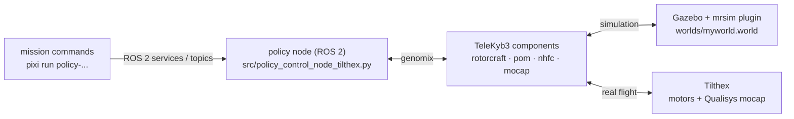

# sensitivity_rl_telekyb — deployment on the Tilthex

ROS 2 node that runs a policy trained with [`sensitivity_rl`](../sensitivity_rl/) on the Tilthex,
through the [TeleKyb3](https://git.openrobots.org/projects/telekyb3/pages/index) components,
both in a Gazebo simulation and on the real vehicle.

Part of [Tilthex Sensitivity RL](../README.md).

## How it works



- **TeleKyb3 components** (GenoM3, pocolibs middleware): `rotorcraft` drives the motors and reads the IMU,
  `pom` estimates the state from IMU and motion capture, `nhfc` is the baseline controller used for manual and
  emergency phases, `optitrack` (simulation) or `qualisys` (real vehicle) read the motion capture.
- **Policy node**: loads a trained policy, reads the state from `pom` and, at 100 Hz, sends the six rotor
  commands to `rotorcraft`. Takeoff, tracking and landing are all done by the policy; `nhfc` is stopped while the
  policy flies.
- **Simulation**: Gazebo with the `mrsim` plugin simulates the Tilthex dynamics
  (model `models/mrsim-tilthex-laas`) and exposes the same interfaces as the real vehicle.

The same code runs in simulation and on the vehicle: `src/tk3_common.py` detects the platform
(`x86_64` → simulation, `aarch64` → onboard computer) and connects the components accordingly.

## Requirements

| | Simulation | Real vehicle |
|---|---|---|
| Machine | Linux x86_64 | onboard computer of the Tilthex (Linux aarch64) |
| Environment | [pixi](https://pixi.sh): ROS 2 Jazzy (RoboStack), Gazebo Ionic (`gz-sim` 9), compilers, JAX | pixi (no Gazebo) |
| TeleKyb3 components | robotpkg | robotpkg |

macOS is not supported: Gazebo and the TeleKyb3 components are only set up for Linux.

## Installation

From this folder:

```bash
# 1. pixi environment: ROS 2, Gazebo, Python dependencies, build tools
pixi install

# 2. GenoM3 and genomix (the Python interface to the components), built inside the pixi environment
pixi run checkout     # clones openrobots-idl, genom3, genomix, python-genomix from git.openrobots.org
pixi run build
```

3. **TeleKyb3 components**, installed with [robotpkg](http://robotpkg.openrobots.org) following the
   [TeleKyb3 installation guide](https://git.openrobots.org/projects/telekyb3/pages/index).
   The components used here are:

   | Package | Used for |
   |---|---|
   | pocolibs (`h2`), genomixd | middleware and component server |
   | `rotorcraft-genom3` | motors and IMU |
   | `pom-genom3` | state estimation |
   | `nhfc-genom3` | baseline controller (manual and emergency phases) |
   | `optitrack-genom3` | motion capture in simulation |
   | `qualisys-genom3` | motion capture on the real vehicle |
   | `maneuver-genom3`, `dynamixel-genom3` | started by `scripts/components.sh` |
   | `mrsim-gazebo`, `optitrack-gazebo` | Gazebo plugins: Tilthex dynamics and simulated motion capture |

   The component executables (`rotorcraft-pocolibs`, `pom-pocolibs`, ...) must be on the `PATH`, and the
   Gazebo plugins on `GZ_SIM_SYSTEM_PLUGIN_PATH`. `src/tk3_common.py` looks for the genomix plugins in
   `$ROBOTPKG_BASE`, in the pixi environment and in `/opt/openrobots`.

   The commented lines in `development/scripts/pixi/checkout_telekyb3.sh` and `build_telekyb3.sh` are the
   alternative of building every component from source inside the pixi environment.

The TeleKyb3 documentation is the reference for the components; a more recent, work-in-progress version
can be built from the Inria mirror, see the [general README](../README.md#telekyb3).

## Run a policy in simulation

Open four terminals in this folder.

```bash
# Terminal 1 — Gazebo, headless (use `pixi run sim` for the graphical interface)
pixi run sim-server

# Terminal 2 — TeleKyb3 components (genomixd, rotorcraft, pom, nhfc, optitrack, ...)
pixi run components

# Terminal 3 — policy node (default policy: configs/policy/PPO/PPO_14)
pixi run policy-control-tilthex
```

```bash
# Terminal 4 — commands
pixi run policy-setup        # configure and connect the components
pixi run policy-start        # arm the motors
pixi run policy-takeoff-zero-point-land 0.8 0.5 0.0 0.0 6.0   # a mission (see below)
```

At the end of each policy flight the node saves the flight in `logs/<policy>_<timestamp>/`
(`data.npz` and plots). Copy those folders into a campaign folder of
[`data_analysis`](../data_analysis/) to analyse them.

To stop everything: `pixi run policy-stop` (stops motors and logging), then `pixi run components --kill`.
`pixi run sim-reset` resets the Gazebo world.

### Choosing the policy

The policy is a run folder of `sensitivity_rl` (`config.json` + `policy_params.msgpack`), selected with the
`policy_dir` parameter:

```bash
pixi run policy-control-tilthex --ros-args -p policy_dir:=configs/policy/SPPO/SPPO_14
```

The two policies of the thesis are in `configs/policy/PPO/PPO_14/` and `configs/policy/SPPO/SPPO_14/`.
To fly a new policy, copy its run folder from `sensitivity_rl/runs/` into `configs/policy/`.
`policy-control-tilthex-pytorch` is a variant of the node for policies exported as PyTorch `.pt` files
(`configs/policy/*.pt`).

## Missions

Each mission is a single command that takes off with the policy, flies the sequence, lands and stops the
motors. Run `policy-setup` and `policy-start` first. Arguments are positional; heights and positions in metres,
angles in degrees, waits in seconds.

| Command | Arguments | Sequence |
|---|---|---|
| `pixi run policy-takeoff-zero-point-land` | `takeoff x y z wait` | takeoff → hold above the origin at the takeoff height → move to (x, y, takeoff + z) → land below that point (point-to-point mission) |
| `pixi run policy-takeoff-zero-attitude-zero-land` | `takeoff roll pitch yaw wait` | takeoff → hold level → attitude target → back to level, keeping the target yaw → landing (attitude mission) |
| `pixi run policy-takeoff-to-point-land` | `takeoff dx dy dz wait` | takeoff → one displacement → landing |
| `pixi run policy-takeoff-attitude-land` | `takeoff roll pitch yaw wait` | takeoff → attitude target → hover → landing |

Single steps are also available, for manual flights:

| Command | Service / topic | Effect |
|---|---|---|
| `pixi run policy-loop-takeoff` | `/policy/takeoff` | takeoff with the policy |
| `pixi run policy-loop-start` / `policy-loop-stop` | `/policy/start`, `/policy/stop` | start / stop the policy loop |
| `pixi run policy-loop-land` | `/policy/land` | landing with the policy |
| `pixi run policy-setpoint x y z roll pitch yaw` | `/policy/setpoint` | new position and attitude reference |
| `pixi run policy-setattitude roll pitch yaw` | `/policy/attitude_target` | new attitude reference |
| `pixi run policy-takeoff` / `policy-land` | `/control/takeoff`, `/control/land` | takeoff / landing with the baseline controller (nhfc) |
| `pixi run policy-pid-start` / `policy-pid-stop` / `policy-go` | `/policy/pid_*` | fly with the baseline controller |
| `pixi run policy-stop` | `/control/stop` | stop motors and logging |
| `pixi run policy-battery`, `policy-telemetry` | — | battery level, live telemetry |

### Node parameters

Set with `--ros-args -p name:=value`.

| Parameter | Default | Meaning |
|---|---|---|
| `policy_dir` | `configs/policy/PPO/PPO_14` | policy run folder |
| `frequency_hz` | `100.0` | control frequency |
| `policy_duration` | `1000.0` | maximum duration of a policy flight [s] |
| `takeoff_height`, `takeoff_ramp_rate_mps` | `0.5`, `0.2` | takeoff reference and its ramp |
| `custom_log_dir` | empty | log folder (default `logs/<policy>_<timestamp>/`) |
| `enable_action_bias`, `drone_mass_kg`, `tilt_angle_deg` | `false`, `2.950`, `20.0` | optional bias of the actions around the hover thrust |
| `skip_plots`, `plot_formats` | `false`, `['png']` | plots saved with each flight |

## Real flights

On the Tilthex the node runs on the onboard computer, reached over SSH. The components and the node are the
same as in simulation; `src/tk3_common.py` switches automatically to the Qualisys motion capture and to the
serial link of the flight controller. The address of the motion-capture server and the serial device are
set in `src/tk3_common.py`.

Typical session, one SSH terminal each:

1. `pixi run components` — start the components;
2. `pixi run policy-control-tilthex --ros-args -p policy_dir:=...` — start the node;
3. `pixi run policy-setup`, `pixi run policy-start`, then the mission command;
4. a terminal kept ready for `pixi run policy-land` or `pixi run policy-stop`, and `pixi run components --kill`.

The code flown in the thesis campaign (May 2026) is at the git tag `flight-campaign`.

## Monte Carlo campaigns in simulation

`src/run_campaign.py` runs a policy many times in Gazebo, each time on a Tilthex model with randomly perturbed
parameters (mass, inertia, centre of mass, propeller tilt, thrust coefficient), written into
`models/mrsim-tilthex-laas/tilthex_laas.sdf` from the template. It starts Gazebo, the components and the node by
itself. The campaign is set by the constants at the top of the file (`TASK_TYPE`, `POLICY_NAME`,
`TARGET_POSE`, `NUM_MC_RUNS`, ranges of the parameters):

```bash
pixi run python src/run_campaign.py      # results in campaigns/<policy>_campaign_<timestamp>/
```

`POLICY_NAME` is a path relative to `configs/policy/` (for example `SPPO/SPPO_14`).

## Remote visualisation

On a remote machine, run the simulation headless together with a websocket server and watch it from a
browser on your computer:

```bash
pixi run sim-remote
```

Then open <https://app.gazebosim.org/visualization> and connect to `wss://<REMOTE_IP>:9002`
(open `https://<REMOTE_IP>:9002` once first, to accept the self-signed certificate in `.ssl/`).

## Folder layout

```
src/
├── policy_control_node_tilthex.py         # ROS 2 policy node and mission commands
├── policy_control_node_tilthex_pytorch.py # same, for PyTorch policies
├── policy.py, networks.py                 # loading and evaluation of a JAX policy
├── tk3_common.py                          # TeleKyb3 components setup (simulation / real vehicle), state, logging
├── tk3-tilthex-control.py                 # interactive console on the components (pixi run tilthex-control)
├── run_campaign.py                        # Monte Carlo campaigns in simulation
└── extract_noise_stds.py                  # noise standard deviations of the state estimate, from hovering flights
configs/policy/                            # policies (PPO_14, SPPO_14, PyTorch exports)
models/                                    # Gazebo models: mrsim-tilthex-laas, propeller
worlds/myworld.world                       # simulation world
scripts/                                   # components and websocket launchers
development/scripts/pixi/                  # checkout, build and activation scripts
logs/, campaigns/                          # outputs (ignored by git)
```

## Verification status

The simulation and the real flights of the thesis ran with the code at tag `flight-campaign`.
After the clean-up of October 2026 (quadrotor and old Tilthex models removed, single world) the code was
checked statically — every script compiles, every pixi task and every model referenced by the world exists —
but the simulation was not run again.
